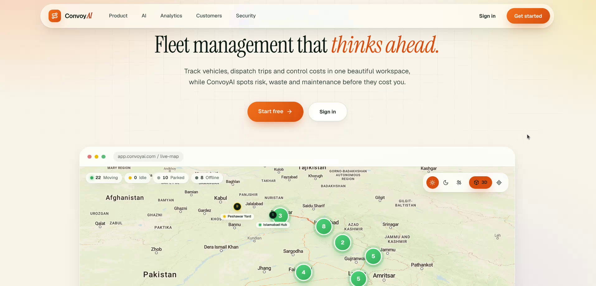
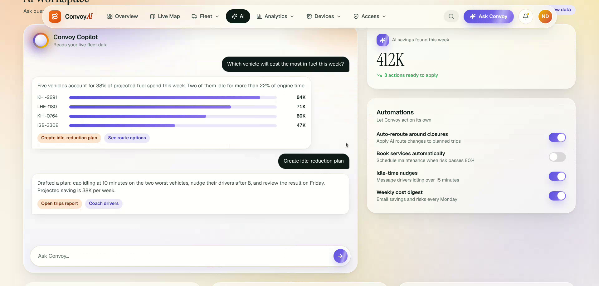
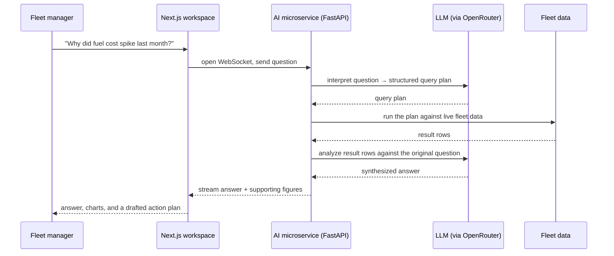
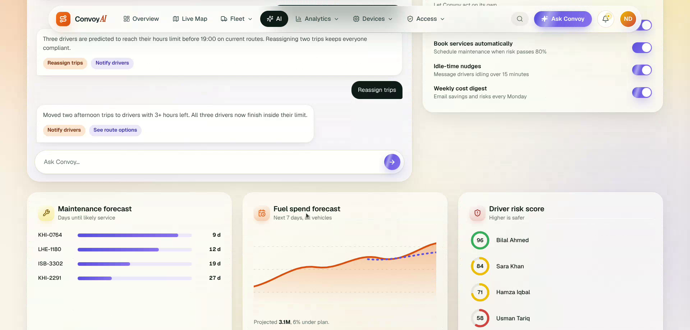
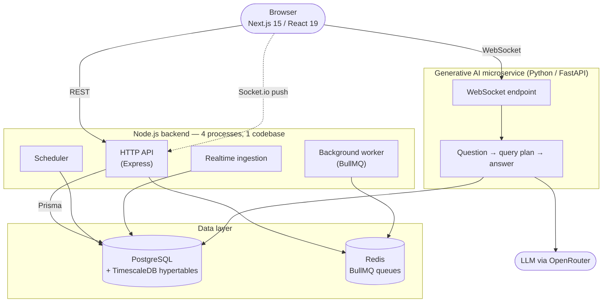
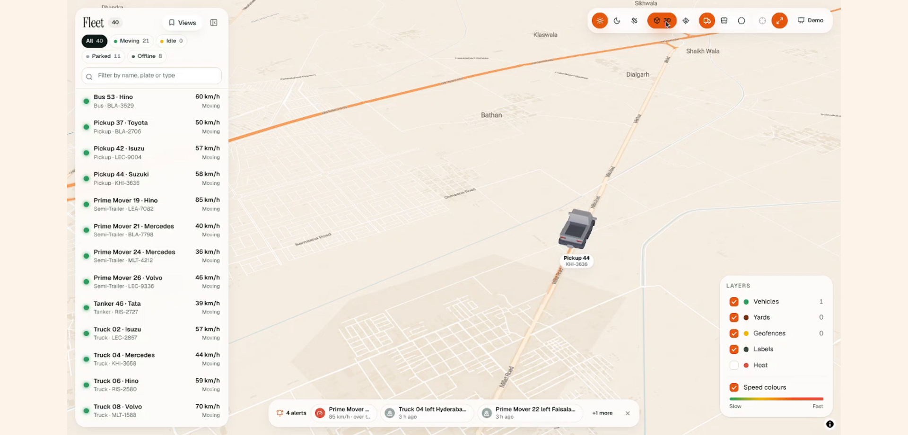
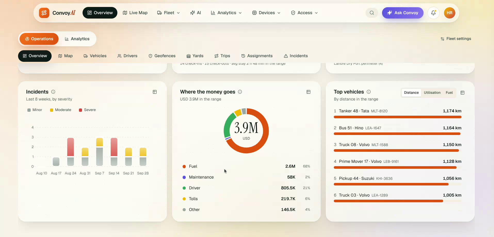
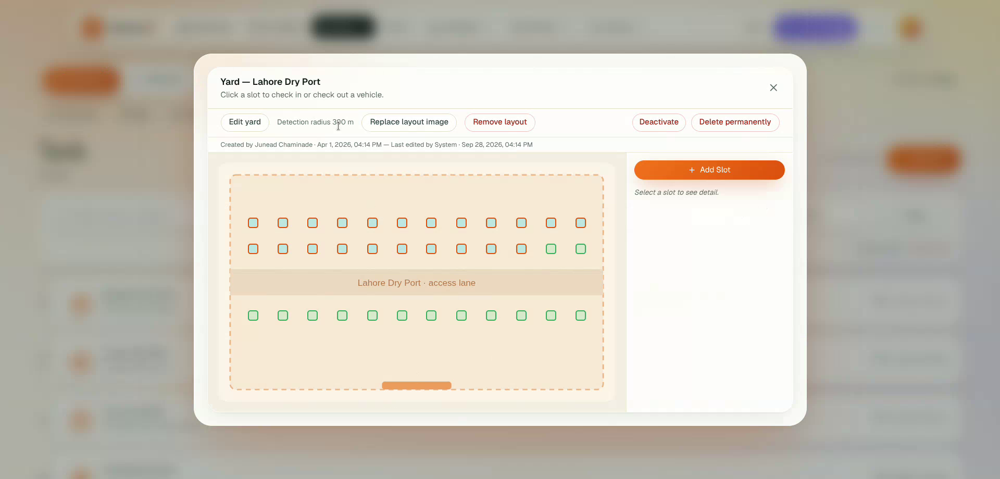

# ConvoyAI

**An enterprise fleet operations platform built around generative AI and a database-enforced, multi-tenant permission system.** Vehicles, drivers, trips, yards, maintenance, fuel, compliance and billing all live under one roof — queried, forecast and explained in plain English by an LLM-powered copilot built on top of the same live data, not a bolt-on chatbot.

[](https://github.com/ahm-mad/ConvoyAI/actions/workflows/ci.yml) 
        

---

### Contents

[What this is](#what-this-is) · [Generative AI copilot](#the-generative-ai-copilot) · [At a glance](#at-a-glance) · [Enterprise RBAC](#enterprise-rbac--multi-tenancy) · [Architecture](#architecture) · [Fleet operations](#fleet-operations) · [Built for scale](#built-for-scale) · [Also in the box](#also-in-the-box) · [Getting started](#getting-started) · [Project structure](#project-structure)

<p align="center"></p>

## What this is

A company onboards its fleet — vehicles, drivers, trips, yards, geofences — and runs the entire operation from one workspace: live positions on a 3D map, fuel/maintenance/compliance tracking, dispatch, CRM & billing, and a **generative-AI copilot that can be asked plain-English questions about the fleet's own data** ("why did fuel cost spike last month?", "which vehicles are near their maintenance window?") and answers with real numbers, charts and drafted action plans, not canned responses.

Underneath, every one of those questions and every page load is authorized by a **module-based, company-scoped permission system** — not a handful of `if (user.isAdmin)` checks sprinkled through the app, but a real RBAC model with protected roles, per-module permission grants, and a reserved super-admin tier.

It is a **production system, built solo from scratch** and used by real fleet operators, who get answers from their own data in seconds instead of waiting on an analyst. The screenshots and the data in this repository are a **synthetic dataset**, so no customer data appears anywhere in the code, the screenshots or the history.

> **About this repository.** This is the public showcase edition of a system I built and ran in production, rebranded and loaded with a synthetic dataset. It moved to my personal GitHub account in September 2026, so the commit history here begins then; the original working history is in a private repository.

## The generative AI copilot

This is the project's centerpiece, and the reason the backend exists as a service-oriented platform rather than a plain CRUD API: **a dedicated LLM integration, not a chat widget wired to a generic prompt.** A fleet manager asks a real question in plain English; the system interprets it, grounds it in the fleet's own live data, and generates an answer — numbers, charts and a drafted action plan, not a canned response.

<p align="center"></p>



A single conversation can move from a cost breakdown to a fully drafted idle-reduction plan, with the workspace surfacing the dollar impact of each suggestion inline — the kind of back-and-forth a fleet analyst would normally spend an afternoon building in a spreadsheet.

Beyond the conversational layer, the same workspace runs standing **forecasts** — maintenance due projections, a fuel-spend trendline, and per-driver risk scoring — so the AI isn't only reactive to questions, it's also surfacing what's coming before anyone has to ask.

<p align="center"></p>

## At a glance

|                   |                                                                                                                                                                                                                                                                                          |
| ----------------- | ---------------------------------------------------------------------------------------------------------------------------------------------------------------------------------------------------------------------------------------------------------------------------------------- |
| **Generative AI** | A dedicated Python/FastAPI AI microservice that turns a natural-language question into a query plan, runs it against live fleet data, and streams an LLM-synthesized answer back over WebSocket — plus a forecasting layer (maintenance due, fuel-spend projection, driver risk scoring) |
| **Permissions**   | Module-based RBAC — company-scoped roles, per-module permission grants, protected/reserved role tiers, a separate super-admin layer — enforced in the backend on every request                                                                                                           |
| **Backend**       | Node.js + Express, 30 feature modules behind a repository → service → controller layering, dependency-injected via Awilix                                                                                                                                                                |
| **Processes**     | 4 independent services from one codebase — HTTP API, realtime ingestion, scheduler, background worker — so a slow job never blocks a request                                                                                                                                             |
| **Data**          | PostgreSQL (TimescaleDB) with hypertables for the fleet's time-series data, Prisma as the typed query layer, Redis + BullMQ for async/queued work                                                                                                                                        |
| **Frontend**      | Next.js 15 App Router, React 19, TypeScript, a hand-built design-token system (no component-library skin), a 3D live fleet map (deck.gl + MapLibre + three.js)                                                                                                                           |
| **Type safety**   | Strict-leaning TypeScript on both sides, Zod validation on every backend input, 145 backend test files                                                                                                                                                                                   |
| **Realtime**      | Socket.io pushes live fleet state to the browser — no polling                                                                                                                                                                                                                            |

## Enterprise RBAC & multi-tenancy

Every company on the platform is its own tenant. Roles are **module-based**: a role is a named bundle of per-module permission grants (dashboard, fleet, role-management, member-management, …), assigned to users and checked on the backend for every request — the frontend hides what a user can't do, but the backend is the actual enforcement boundary.

- **Protected & reserved roles** — a baseline "company owner" role can't be renamed, demoted, or deleted out from under a tenant, even by another admin.
- **Super-admin tier**, separate from company-level roles — platform-level operators see cross-company analytics and company management that no tenant role can reach.
- **Scoped module catalog** — permissions are granted per module, not as a single coarse "admin" flag, so a tenant can hand a support role read-only fleet access without also handing over billing or role management.
- **JWT-embedded authorization** — roles and permissions travel with the session token; a permission change takes effect at next login, not mid-session, by design.

## Architecture



A layered backend convention, enforced across all 30 modules:

```
modules/<domain>/<domain>.repository.ts   Data access only — Prisma queries, nothing else.
modules/<domain>/<domain>.service.ts      Business logic. Depends on the repository, never Prisma directly.
modules/<domain>/<domain>.controller.ts   HTTP boundary — validates with Zod, calls the service, shapes the response.
```

Cross-module dependencies are wired explicitly in `container.ts` (Awilix), each consumer typing the slice of another module's repository it actually needs — no module reaches into another's internals directly.

## Fleet operations

<p align="center"></p>

- **Live 3D map** — real vehicle models (not flat pins), road-following movement, speed-colored trails, saved camera views, a heat-density layer, satellite/night/day modes.
- **Vehicles & drivers** — assignment history, documents, compliance status.
- **Trips & dispatch** — planned/actual routes, schedules, yard check-in/out.
- **Yards** — a visual slot-grid for yard capacity and vehicle placement.
- **Geofences** — entry/exit activity feeding the alerting pipeline.
- **Fuel, maintenance & compliance** — cost breakdowns, maintenance-due tracking, compliance scoring.
- **CRM & billing** — customer accounts tied into company-scoped subscriptions and plans.
- **Analytics** — cost-breakdown donut, incident severity, top-vehicle rankings, utilisation and on-time delivery KPIs.

<p align="center"> </p>

## Built for scale

- **TimescaleDB hypertables** for the fleet's highest-volume time-series data (vehicle telemetry and position history), so time-window queries stay fast as history grows, instead of degrading on a plain row-store table.
- **Four independent processes from one codebase** — the HTTP API, realtime ingestion, the scheduler, and a BullMQ-backed background worker — so a long-running job or a burst of realtime events never blocks an API request.
- **Redis + BullMQ** queue async work (ingestion processing, rule evaluation) off the request path.
- **Socket.io realtime** pushes fleet state changes to connected clients directly — no dashboard polling.

## Also in the box

- **Multi-tenant companies, subscriptions & plans** — Stripe-style plan/entitlement modeling scoped per company.
- **Bulk CSV import/export** across major entities.
- **i18n** — English and Arabic, including RTL.
- **Notifications** — in-app + a rules/alert evaluation pipeline.
- **Design-token system** — every color, radius, shadow and motion value comes from a central token layer (light theme, no component-library skin), so the whole UI restyles from one place.
- **Strong typing end to end** — Prisma-generated types on the backend, Zod validation on every write, 145 backend test files.

## Getting started

Two independent apps in one repository — install and run each separately.

**Frontend** (Next.js):

```bash
npm install
npm run dev
npm run typecheck
```

**Backend** (Node.js API + AI microservice):

```bash
cd backend
npm install
npm run db:up                # Postgres (TimescaleDB) + Redis via Docker
npx prisma migrate deploy
npm run dev                  # HTTP API
npm run dev:worker           # background worker (separate terminal)
npm run dev:scheduler        # scheduler (separate terminal)

cd ai_layer
pip install -r requirements.txt
uvicorn app.main:app --reload
```

Required environment variables (database/Redis URLs, JWT secrets, LLM key, …) and their validation rules are documented in `backend/deploy/02-environment-variables.md`; the process refuses to start and names the missing/malformed variable if one is wrong. Full deployment docs (Docker and PM2 paths, external services) are in `backend/deploy/`.

## Project structure

```
src/                      Frontend — Next.js App Router, React, TypeScript
  components/              UI primitives + feature components
  screens/                 Page-level screens (routed via thin app/ re-exports)
  styles/                  Design tokens + semantic component classes

backend/
  src/
    modules/<domain>/       repository.ts (reads) / service.ts (logic) / controller.ts (HTTP)
    platform/                db, cache, realtime, auth, logging, timeseries migrations
    main.http.ts             HTTP API process
    main.mqtt.ts              realtime ingestion process
    main.scheduler.ts         scheduled jobs process
    main.worker.ts            BullMQ background worker process
  ai_layer/                 Python/FastAPI AI microservice (NL question answering)
  prisma/                   Schema + migrations
  deploy/                   Docker + PM2 deployment docs

docs/screenshots/          README images
```

---

_A production system built solo from scratch. Screenshots and data in this repository are synthetic; no customer data appears anywhere in it._
